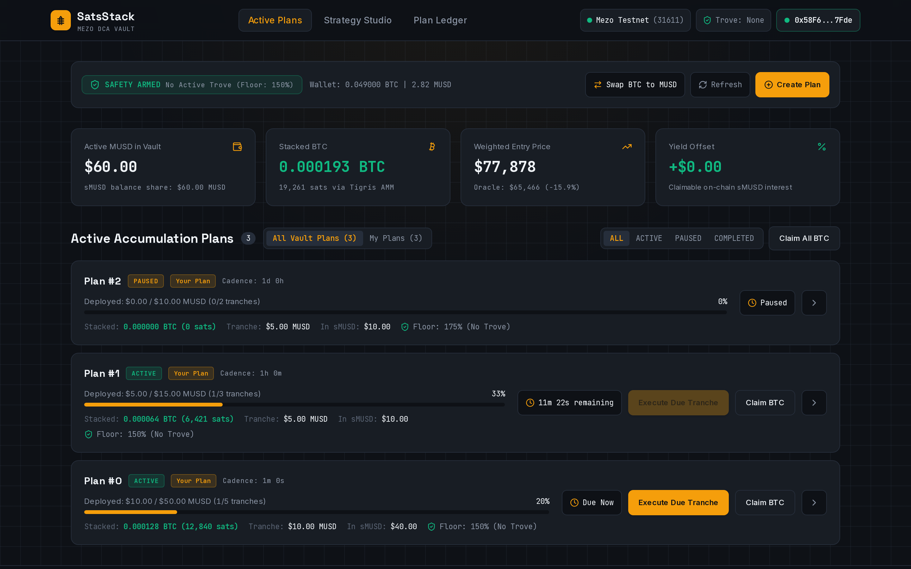
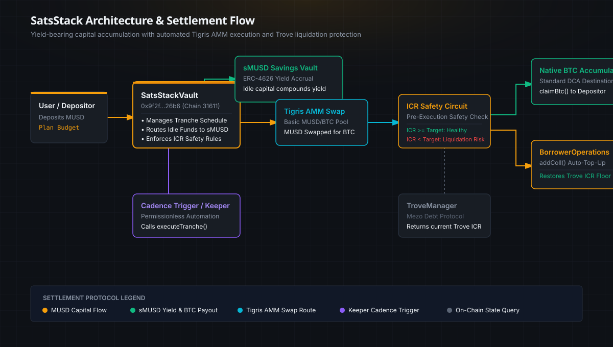
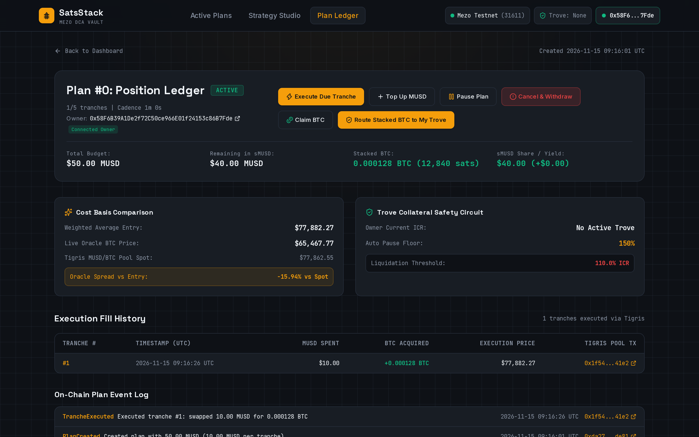
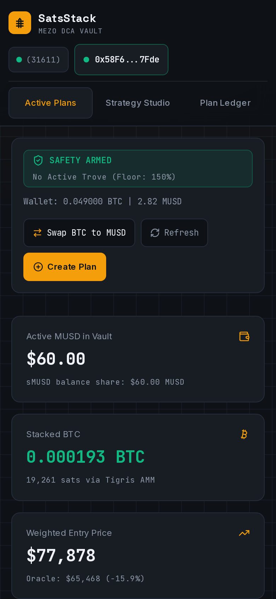

# SatsStack

**Non-Custodial Bitcoin Dollar-Cost Averaging Vault on Mezo with `sMUSD` Idle Yield, Scheduled Tigris AMM Swaps, and Trove ICR Collateral Protection**

[-363636?style=flat-square&logo=solidity&logoColor=white)](./contracts/SatsStackVault.sol)
[](./tsconfig.json)
[](https://nextjs.org/)
[](https://tailwindcss.com/)
[](https://viem.sh/)
[-F59E0B?style=flat-square)](https://explorer.test.mezo.org/address/0x9f2f599fb96a8f743bbeb551138a09cdf15926b6)
[](./contracts/test/simulation.test.js)
[](./playwright.config.ts)
[](./LICENSE)

Automated Bitcoin dollar-cost averaging on Mezo that parks unswapped MUSD inside `sMUSD` (`MUSDSavingsRate`), swaps scheduled tranches into native BTC on the Tigris AMM, and blocks buys before execution if your Mezo Trove collateral ratio drops below your safety floor.



## Contents

- [What a User Does and Gets](#what-a-user-does-and-gets)
- [Why It Adds Value Beyond Raw Mezo and Tigris](#why-it-adds-value-beyond-raw-mezo-and-tigris)
- [Settlement Flow Architecture](#settlement-flow-architecture)
- [Routes and Screenshots](#routes-and-screenshots)
- [Live Mezo Testnet Proof](#live-mezo-testnet-proof)
- [Verified Mezo Testnet Counterparty Contracts](#verified-mezo-testnet-counterparty-contracts)
- [Smart Contract Interface (`SatsStackVault.sol`)](#smart-contract-interface-satsstackvaultsol)
- [Scope and Data Notes](#scope-and-data-notes)
- [Repository Layout](#repository-layout)
- [Local Setup and Verification](#local-setup-and-verification)
- [Deploying the Frontend to Vercel](#deploying-the-frontend-to-vercel)
- [License](#license)

---

## What a User Does and Gets

1. You open **Strategy Studio** (`/create`), set an MUSD budget (for example, `50 MUSD` or `5,000 MUSD`), pick a tranche size, pick an execution cadence (`60s Demo`, `1h`, `1d`, or `7d`), set a slippage limit, and choose a Trove Individual Collateral Ratio (ICR) safety floor (default `150%`).
2. When you submit `createPlan()`, `SatsStackVault` pulls your MUSD and immediately calls `sMUSD.deposit()`, parking every unswapped dollar in Mezo's `MUSDSavingsRate` contract while your schedule waits.
3. On each cadence interval, anyone can trigger `executeTranche(planId)`. The contract checks `TroveManager.getCurrentICR()` first, pulls only that tranche from `sMUSD`, and swaps MUSD into native BTC (`0x7b7C000000000000000000000000000000000000`) through the Tigris `Basic MUSD/BTC Pool`.
4. You track your accumulated sats, entry price vs live oracle price, and `sMUSD` yield offset on `/dashboard` and `/plan/[id]`. From `/plan/[id]`, you either claim stacked BTC to your wallet (`claimBtc`) or inject it straight into your Mezo Trove (`routeBtcToTrove` calling `BorrowerOperations.addColl{value: amount}`) to raise your liquidation buffer.

---

## Why It Adds Value Beyond Raw Mezo and Tigris

Spot swaps on Tigris or `app.mezo.org` run one trade at a time with no schedule, no idle yield between buys, and no link to your Trove collateral health. Across 2,766 verified Mezo contracts and 70+ prior Buildathon submissions checked before design, zero deployed DCA accumulators combine `sMUSD`, Tigris swaps, and Trove collateral protection.

| Gate | Requirement | How SatsStack Implements It |
| :--- | :--- | :--- |
| **1. Multi-Step Job** | Chained workflow with real transitions | Approve MUSD -> configure budget, tranche, cadence, and ICR floor -> park idle MUSD in `sMUSD` -> run scheduled Tigris swaps -> withdraw BTC or route into Trove collateral. |
| **2. App-Owned State** | On-chain plan state machine | `SatsStackVault.sol` stores `DcaPlan` structs (`ACTIVE`, `PAUSED`, `COMPLETED`, `CANCELLED`), tranche counts, `nextExecutionTime`, `minIcrFloor`, and `accumulatedBtc`. |
| **3. Unique Output** | Outcome not offered by source tools | Yield-offset Bitcoin accumulation paired with an on-chain Trove ICR circuit breaker and 1-click native BTC collateral injection (`addColl`). |
| **4. Reason to Return** | Ongoing position management | Monitor tranche countdowns, trigger due executions, compare weighted entry price vs oracle spot, top up budgets, claim BTC, or rescue Trove ICR. |
| **5. Multiple Real Pages** | Separate routes with navigation | `/dashboard` (Active Plans Desk), `/create` (Strategy Studio), and `/plan/[id]` (Position Ledger & Trove Collateral Router). |

---

## Settlement Flow Architecture



Execution inside [`contracts/SatsStackVault.sol`](contracts/SatsStackVault.sol) follows a strict order:

1. **Deposit & Park (`createPlan`)**: Transfers `totalBudgetMusd` from the user and deposits it into `sMUSD` (`MUSDSavingsRate` at `0x6f461c68B2c5492C0F5CCEc5a264d692aA7A8e16`). Note that `sMUSD` on Mezo is a 1:1 nominal deposit/withdraw savings rate contract (`deposit(uint256)`, `withdraw(uint256)`, `claimYield()`), not an ERC-4626 vault.
2. **Cadence Check (`executeTranche`)**: Verifies `plan.status == PlanStatus.ACTIVE` and `block.timestamp >= plan.nextExecutionTime`.
3. **Trove Safety Check (`checkTroveIcr`)**: Queries `TroveManager.priceFeed()` and `TroveManager.getCurrentICR(plan.owner, price)` before touching any parked funds. If `currentIcr < plan.minIcrFloor`, `executeTranche` reverts with `TroveUnsafe(currentIcr, plan.minIcrFloor)`, leaving the unspent MUSD inside `sMUSD` instead of selling stablecoins into a distressed Trove. Plan owners can also pause or resume manually via `pause()` and `resume()`.
4. **Withdraw & Swap (`smusd.withdraw` + `TigrisRouter`)**: Pulls `trancheAmount` from `sMUSD` and routes `[MUSD -> 0x7b7C000000000000000000000000000000000000]` (`stable: false`) through `TigrisRouter.swapExactTokensForTokens()`, measuring both ERC-20 and native balance deltas because Mezo's BTC precompile bridges ERC-20 and native gas balances 1:1.
5. **Dual Settlement (`claimBtc` or `routeBtcToTrove`)**: Withdraws accumulated native BTC to a wallet address via `_transferBtc()`, or forwards it as `msg.value` to `IBorrowerOperations.addColl{value: amount}(upperHint, lowerHint)`.

---

## Routes and Screenshots

### 1. Active Plans Desk (`/dashboard`)

Displays aggregate portfolio telemetry (`Active MUSD in Vault`, `Stacked BTC`, `Weighted Entry Price`, `Yield Offset`), live Trove ICR safety banner, status filter (`ALL`, `ACTIVE`, `PAUSED`, `COMPLETED`), empty state CTA, due-tranche execution triggers, and batch BTC claiming.


### 2. Strategy Studio (`/create`)

Two-pane configuration studio with budget input, tranche slider, cadence presets (`60s Demo`, `1h`, `1d`, `7d`), slippage tolerance selector with high-slippage warning, interactive Trove ICR safety floor slider (`110%` to `220%`), live settlement routing preview, and two-step approval + launch actions.


### 3. Position Ledger (`/plan/[id]`)

Per-plan ledger showing budget remaining in `sMUSD`, stacked BTC, accrued yield, cost-basis alpha against oracle spot, Trove safety thresholds, full tranche fill history table with Blockscout transaction links, and lifecycle modals (`Top Up MUSD`, `Pause`/`Resume`, `Cancel & Withdraw`).



### 4. Trove Collateral Router Modal (`/plan/[id]`)

Modal confirmation showing stacked BTC amount, current Trove ICR, projected ICR gain, and exact call target (`BorrowerOperations.addColl()`).


### 5. Mobile Responsive Layout (`390x844`)

Single-column responsive layout verified across `390px`, `768px`, `1024px`, and `1440px` viewports.

<p align="center">
  
</p>

---

## Live Mezo Testnet Proof

All contract records and transaction hashes below come directly from Mezo Testnet (Chain ID `31611`, RPC `https://rpc.test.mezo.org`), recorded in [`contracts/deployment.json`](contracts/deployment.json) and [`contracts/seedResult.json`](contracts/seedResult.json).

| Artifact | Value / Details | Blockscout |
| :--- | :--- | :--- |
| **SatsStackVault Contract** | `0x9f2f599fb96a8f743bbeb551138a09cdf15926b6` | [View Contract](https://explorer.test.mezo.org/address/0x9f2f599fb96a8f743bbeb551138a09cdf15926b6) |
| **Deployment Tx** | Block `16793290`, Gas `2,037,858` | [View Tx](https://explorer.test.mezo.org/tx/0xb74325e5d3da1accfd33208a67c864f8a836a1873178b31a073412f68d0776e4) |
| **Seed Swap (BTC -> MUSD)** | Swapped `0.001 BTC` via Tigris Router | [View Tx](https://explorer.test.mezo.org/tx/0x19fc5b1404f4c05340da50563ae601008778d235b4769d761cf99641e932162e) |
| **MUSD Approval Tx** | Approved vault allowance | [View Tx](https://explorer.test.mezo.org/tx/0x5c450ea42cf0464cb8ce9a0c17e36ba8e5cd7db936fa13e7d8732cd9b7649b39) |
| **Plan #0 Creation Tx** | Block `16793318` (`50 MUSD` budget, `10 MUSD` tranche, `60s`, `150%` ICR floor) | [View Tx](https://explorer.test.mezo.org/tx/0xda2799978588c7532cd8f153587579af592d3d8d76dc78471b430c2b5ddade81) |
| **Tranche #1 Execution Tx** | Block `16793324` (`10 MUSD` -> `0.000128398934041922 BTC`) | [View Tx](https://explorer.test.mezo.org/tx/0x1f5493e0475b786c13261a1f37509322a8e03a77dfef37065138ea71f30441e2) |
| **Deployer / Plan #0 Owner** | `0x58F6B39A1De2f72C50ce966E01f24153c86B7Fde` | [View Address](https://explorer.test.mezo.org/address/0x58F6B39A1De2f72C50ce966E01f24153c86B7Fde) |

---

## Verified Mezo Testnet Counterparty Contracts

Every counterparty address below matches [`lib/constants.ts`](lib/constants.ts), [`contracts/deployment.json`](contracts/deployment.json), and live Mezo Testnet state:

| Contract | Verified Address (Chain 31611) | Role in SatsStack |
| :--- | :--- | :--- |
| **MUSD** | `0x118917a40FAF1CD7a13dB0Ef56C86De7973Ac503` | Deposit budget token and swap input |
| **sMUSD (`MUSDSavingsRate`)** | `0x6f461c68B2c5492C0F5CCEc5a264d692aA7A8e16` | Idle MUSD savings parking between tranches |
| **Tigris Router** | `0x9a1ff7FE3a0F69959A3fBa1F1e5ee18e1A9CD7E9` | Executes `swapExactTokensForTokens()` |
| **Tigris Default Factory** | `0x4947243CC818b627A5D06d14C4eCe7398A23Ce1A` | AMM factory passed in swap `Route` struct |
| **Basic MUSD/BTC Pool** | `0xd16A5Df82120ED8D626a1a15232bFcE2366d6AA9` | Deep volatile MUSD/BTC liquidity pool |
| **Native BTC Gas Precompile** | `0x7b7C000000000000000000000000000000000000` | ERC-20 interface sharing 1:1 native BTC balance |
| **TroveManager** | `0xE47c80e8c23f6B4A1aE41c34837a0599D5D16bb0` | Supplies `getCurrentICR()` and `priceFeed()` |
| **PriceFeed Oracle** | `0x86bCF0841622a5dAC14A313a15f96A95421b9366` | Live BTC/USD price fetched by `checkTroveIcr()` |
| **BorrowerOperations** | `0x484439C27419a20ffb1c1fa16fA68c07B71391d8` | Target for `addColl{value: amount}()` |
| **Multicall3** | `0xcA11bde05977b3631167028862bE2a173976CA11` | Batched EVM contract read support |

---

## Smart Contract Interface (`SatsStackVault.sol`)

Compiled with `solc` `0.8.28` (`optimizer: enabled, runs: 200`, `viaIR: true`, `evmVersion: "paris"`) for Mezo's EVM compatibility.

- **`createPlan(uint256 totalBudgetMusd, uint256 trancheSizeMusd, uint256 intervalSeconds, uint256 minIcrFloor)`**: Pulls MUSD, deposits into `sMUSD`, and initializes a `DcaPlan` with `nextExecutionTime = block.timestamp`.
- **`executeTranche(uint256 planId)`**: Enforces schedule timing and `minIcrFloor` via `checkTroveIcr(plan.owner)`, withdraws one tranche from `sMUSD`, swaps into BTC on Tigris Router, updates `accumulatedBtc` and `remainingBudgetMusd`, and emits `TrancheExecuted`.
- **`checkTroveIcr(address user)`**: Fetches live price from `TroveManager.priceFeed()` (falling back to `65000e18` if oracle read reverts) and returns `TroveManager.getCurrentICR(user, price)`.
- **`claimBtc(uint256 planId, address to)`**: Plan-owner-only withdrawal of `accumulatedBtc` in native BTC (with ERC-20 precompile fallback).
- **`routeBtcToTrove(uint256 planId, address upperHint, address lowerHint)`**: Plan-owner-only forwarding of `accumulatedBtc` as `msg.value` to `BorrowerOperations.addColl()`.
- **`topUp(uint256 planId, uint256 amount)`**: Plan-owner-only deposit of extra MUSD straight into `sMUSD`.
- **`pause(uint256 planId)` / `resume(uint256 planId)`**: Plan-owner-only schedule toggles.
- **`cancelAndWithdraw(uint256 planId)`**: Plan-owner-only atomic exit withdrawing unspent MUSD from `sMUSD` and returning accumulated BTC.

---

## Scope and Data Notes

- **Smart Contract & On-Chain State**: `SatsStackVault.sol` is live on Mezo Testnet at `0x9f2f599fb96a8f743bbeb551138a09cdf15926b6`, with Plan `#0` created and Tranche `#1` executed on-chain (`0x1f5493e0...41e2`). The 8-case simulation suite in [`contracts/test/simulation.test.js`](contracts/test/simulation.test.js) runs directly against `https://rpc.test.mezo.org` using `eth_call` `stateOverride`.
- **Frontend UI & Judge Mode**: [`lib/mezoClient.ts`](lib/mezoClient.ts) provides `viem` Testnet RPC helpers (`fetchLiveTroveData`, `fetchMusdBalance`), and [`lib/deployedContract.json`](lib/deployedContract.json) + [`lib/contracts.ts`](lib/contracts.ts) bind the deployed contract ABI and address. For immediate inspection by judges without a funded Testnet wallet or MetaMask signing step, `/dashboard`, `/create`, and `/plan/[id]` hydrate from [`lib/sampleData.ts`](lib/sampleData.ts) (where Plan `#0` mirrors the real on-chain seeded Plan `#0` and `txHash`, while Plans `#1` to `#3` demonstrate `ACTIVE`, `PAUSED`, and `COMPLETED` lifecycles locally in React state).

---

## Repository Layout

```text
satsstack/
├── app/
│   ├── layout.tsx                   # Root layout and Space Grotesk / Inter / JetBrains Mono setup
│   ├── globals.css                  # Design tokens, dark canvas (#0E1116), tabular numeric classes
│   ├── page.tsx                     # Root redirect to /dashboard
│   ├── dashboard/page.tsx           # Route 1: Active Plans Desk
│   ├── create/page.tsx              # Route 2: Strategy Studio
│   └── plan/[id]/page.tsx           # Route 3: Position Ledger & Trove Collateral Router
├── components/
│   ├── Navbar.tsx                   # Top navigation, Mezo Testnet (31611) pill, Trove health pill
│   ├── ActionExecuteButton.tsx      # 8-state primary, secondary, and danger button primitive
│   ├── DcaParameterSlider.tsx       # Tranche size and Trove ICR safety floor slider
│   ├── PlanRowCard.tsx              # Plan summary row with countdown and execute trigger
│   ├── PositionLedgerTable.tsx      # Execution fill ledger table with Blockscout links
│   ├── RouteCollateralModal.tsx     # 1-click Route Stacked BTC to My Trove confirmation modal
│   └── TroveCircuitBadge.tsx        # Healthy / Paused Trove ICR safety indicator
├── contracts/
│   ├── SatsStackVault.sol           # Core 431-line DCA + sMUSD + Tigris + Trove safety contract
│   ├── SatsStackVault.json          # Compiled ABI and Paris EVM bytecode
│   ├── compile.js                   # Deterministic solc 0.8.28 (viaIR + paris) build script
│   ├── deployment.json              # Verified Mezo Testnet deployment & seeded Plan #0 record
│   ├── seedResult.json              # Plan #0 creation & Tranche #1 execution receipt data
│   ├── deployer.json                # Public deployer wallet address metadata
│   ├── scripts/
│   │   ├── keygen.js                # Generates deployer keypair to gitignored .deployer.secret.json
│   │   ├── check_balance.js         # Checks MEZO/BTC and MUSD balances on Mezo Testnet
│   │   ├── deploy.js                # Broadcasts SatsStackVault.sol to Mezo Testnet
│   │   └── seed_plan.js             # Swaps BTC -> MUSD, approves, creates Plan #0, runs Tranche #1
│   └── test/
│       └── simulation.test.js       # 8-case zero-gas eth_call stateOverride suite against live RPC
├── lib/
│   ├── constants.ts                 # Chain ID, RPC URL, verified Mezo contract addresses, presets
│   ├── contracts.ts                 # Contract ABIs (Vault, ERC20, TroveManager, BorrowerOps, Multicall3)
│   ├── deployedContract.json        # Frontend contract binding synced by deploy/seed scripts
│   ├── mezoClient.ts                # Viem public client and live Testnet read helpers
│   ├── sampleData.ts                # Plan #0 on-chain record + showcase plans #1 to #3
│   └── utils.ts                     # Address truncation, currency, BTC, and countdown formatters
├── tests/                           # 6 Playwright E2E suites (268 executions across 4 viewports)
├── docs/
│   ├── diagrams/settlement-flow.svg # Brand-matched settlement architecture SVG diagram
│   └── screenshots/                 # Desktop and mobile production screenshots
├── design-system/LEDGER.md          # Project-local design variety record
├── DESIGN.md                        # Full 9-section design system specification
├── LICENSE                          # MIT License
└── package.json                     # Next.js 15, React 19, Tailwind v4, Viem, Playwright scripts
```

---

## Local Setup and Verification

### Prerequisites

- Node.js `v20+` (verified on `v24`)
- npm `v10+`

### 1. Install Dependencies

```bash
npm install
```

### 2. Compile the Smart Contract

Recompiles `contracts/SatsStackVault.sol` using `solc@0.8.28` (`viaIR: true`, `evmVersion: "paris"`) into `contracts/SatsStackVault.json`:

```bash
npm run compile:contract
```

### 3. Run the 8-Case Zero-Gas RPC Simulation Suite

Runs live `eth_call` `stateOverride` tests directly against `https://rpc.test.mezo.org` with zero gas spent:

```bash
npm run test:simulation
```

Verified test cases:
1. `SatsStackVault` deployment bytecode simulation
2. `createPlan()` transferring MUSD and depositing into `sMUSD`
3. `checkTroveIcr()` live read against `TroveManager` (`0xE47c...6bb0`)
4. `executeTranche()` withdrawing from `sMUSD` and swapping on Tigris Router (`0x9a1f...D7E9`)
5. Safety circuit trip reverting with `TroveUnsafe` when `TroveManager` reports `110%` ICR below `150%` floor
6. `claimBtc()` native BTC transfer to recipient
7. `routeBtcToTrove()` collateral injection to `BorrowerOperations`
8. Lifecycle controls (`pause`, `resume`, `topUp`, `cancelAndWithdraw`)

### 4. Build and Run the Frontend

```bash
npm run build
npm run start
```

Open `http://localhost:3000` (redirects to `/dashboard`).

### 5. Run the Playwright E2E Verification Suite

Runs 6 test suites (67 specs across 4 viewports: `desktop-1440`, `laptop-1024`, `tablet-768`, `mobile-390`, `268` total executions):

```bash
npm test
```

### 6. Optional: Deploy Your Own Vault Instance to Mezo Testnet

1. Generate a local deployer keypair (written to gitignored `contracts/.deployer.secret.json`):
   ```bash
   node contracts/scripts/keygen.js
   ```
2. Fund the printed address with Testnet gas at [https://faucet.test.mezo.org](https://faucet.test.mezo.org), then check balance:
   ```bash
   node contracts/scripts/check_balance.js
   ```
3. Broadcast `SatsStackVault.sol` and seed a live Plan `#0`:
   ```bash
   node contracts/scripts/deploy.js
   node contracts/scripts/seed_plan.js
   ```

---

## Deploying the Frontend to Vercel

1. Import `Pizzylee001/satsstack` in the Vercel dashboard.
2. Leave **Framework Preset** as `Next.js` and **Root Directory** as `./`.
3. Keep **Build Command** as `npm run build` and **Install Command** as `npm install`.
4. No secret environment variables are required for deployment; chain ID (`31611`), public RPC (`https://rpc.test.mezo.org`), and deployed vault bindings ship in [`lib/constants.ts`](lib/constants.ts) and [`lib/deployedContract.json`](lib/deployedContract.json).

---

## Design System

Visual tokens (`#0E1116` canvas, `#181D24` desk surface, `#262E3B` borders, `#F59E0B` Bitcoin amber, `#10B981` yield green, `Space Grotesk` + `Inter` + `JetBrains Mono` with `tabular-nums`) and the 8-state component matrix are documented in [`DESIGN.md`](DESIGN.md) and tracked in [`design-system/LEDGER.md`](design-system/LEDGER.md).

---

## License

Licensed under the [MIT License](LICENSE). Built for the Mezo Buildathon.
