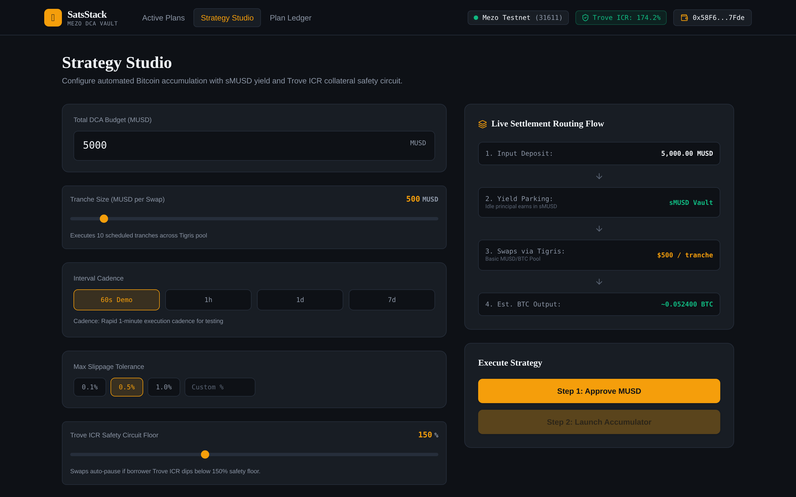
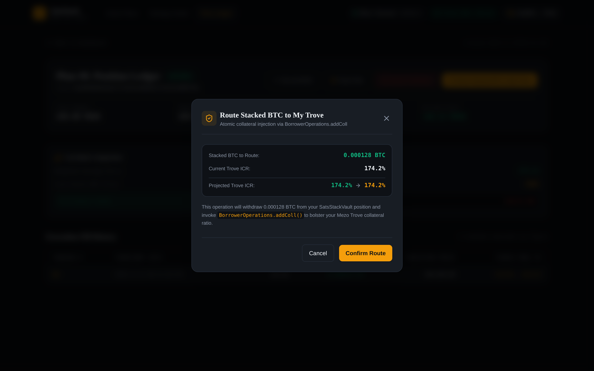

# SatsStack

Automated Bitcoin dollar-cost averaging on Mezo with sMUSD idle yield and Trove liquidation protection.


## Overview

SatsStack is an automated capital accumulator deployed on Mezo Testnet (Chain ID 31611). It solves the capital inefficiency and liquidation risks faced by Bitcoin borrowers and stackers.

When you deposit MUSD into an accumulation strategy, SatsStack deposits your idle principal directly into the sMUSD Savings Vault (ERC-4626) where it compounds continuous yield. At scheduled execution cadences (e.g. 60 seconds, 1 hour, 1 day, or 7 days), a keeper or caller executes a tranche swap across the Tigris AMM Basic MUSD/BTC pool.

Before any swap executes, SatsStack queries the Mezo TroveManager contract. If your Individual Collateral Ratio (ICR) falls below your safety floor (e.g. 150%), the protocol protects your debt position by auto-pausing market swaps. Accumulated Bitcoin can be claimed directly to your wallet or routed in one transaction into `BorrowerOperations.addColl()` to restore your collateral buffer above the 110% liquidation threshold.

## Settlement Flow Architecture

The diagram below details the asset routing and safety circuit architecture:


### Complete Flow Steps

1. **Deposit**: Depositor transfers MUSD into `SatsStackVault.createPlan()`.
2. **Yield Accrual**: The vault deposits idle MUSD into the `sMUSD` Savings Vault, compounding yield between tranches.
3. **Cadence Execution**: Keepers trigger `executeTranche()` when the time interval elapses.
4. **Safety Check**: The vault queries `TroveManager.getCurrentICR()`. If ICR is below the user-defined safety floor, execution reverts (`TroveUnsafe`).
5. **AMM Swap**: The vault redeems tranche MUSD from `sMUSD` and swaps for BTC on the Tigris AMM Router (`swapExactTokensForTokens`).
6. **Settlement Routing**:
   - **Route A (Accumulation)**: User invokes `claimBtc()` to withdraw native Bitcoin to their wallet.
   - **Route B (Liquidation Protection)**: User invokes `routeBtcToTrove()`, which calls `BorrowerOperations.addColl()` to top up debt collateral.

## The 5 Compulsory Minimum-Build Gates

SatsStack is not a read-only viewer or dashboard. It fulfills all 5 minimum-build product criteria:

| Gate | Requirement | SatsStack Implementation |
| :--- | :--- | :--- |
| **1. Multi-Step Job** | Multi-phase operational workflow | Approving MUSD -> configuring tranche cadence, budget, and ICR floor -> depositing into sMUSD yield vault -> executing scheduled Tigris AMM swaps -> routing BTC to wallet or debt collateral. |
| **2. App-Owned State** | Internal business logic and state machine | `SatsStackVault` smart contract tracks plan status (`ACTIVE`, `PAUSED`, `COMPLETED`), tranche budgets, timestamps, ICR thresholds, and accumulated sats per user. |
| **3. Exclusive Output** | Value that exists nowhere else | Automated yield-bearing DCA coupled with automated Mezo Trove liquidation defense. No other protocol combines sMUSD interest offset with debt collateral injection. |
| **4. Reason to Return** | Recurring utility and lifecycle management | Monitoring tranche fills, tracking yield offsets vs spot price, adjusting cadences, topping up budgets, or reallocating Bitcoin collateral as market prices fluctuate. |
| **5. Multiple Real Routes** | Distinct functional pages with client-side navigation | 3 fully realized routes: `/dashboard` (Active Plans Desk), `/create` (Strategy Studio), and `/plan/[id]` (Position Ledger and Trove Collateral Router). |

## Production Screenshots

### Active Plans Desk (`/dashboard`)
Displays aggregate vault metrics, live Trove ICR telemetry, and all active accumulation plans with instant execution triggers.


### Strategy Studio (`/create`)
Configures new accumulation plans with budget sliders, cadence selectors, slippage tolerance, and Trove ICR safety circuit settings.



### Position Ledger & Telemetry (`/plan/0`)
Shows real-time on-chain metrics for Plan #0, execution history, cost basis comparison against live oracles, and emergency lifecycle controls.


### Trove Collateral Router Modal
Enables atomic collateral injection into Mezo BorrowerOperations to elevate the borrower ICR and guard against liquidation.



### Mobile Responsive Interface (390px Viewport)
Engineered for mobile devices with responsive layouts, accessible navigation, and 44px minimum tap targets.

<p align="center">
  
</p>

## Live Mezo Testnet Proof Table

SatsStack is live and verified on the Mezo Testnet (Chain ID 31611). All contract deployments, swaps, and executions are verified on Blockscout:

| Item | Details | Blockscout Link |
| :--- | :--- | :--- |
| **SatsStackVault Contract** | `0x9f2f599fb96a8f743bbeb551138a09cdf15926b6` | [View Contract](https://explorer.test.mezo.org/address/0x9f2f599fb96a8f743bbeb551138a09cdf15926b6) |
| **Deployment Transaction** | Block 16793290 (`0xb743...76e4`) | [View Deployment Tx](https://explorer.test.mezo.org/tx/0xb74325e5d3da1accfd33208a67c864f8a836a1873178b31a073412f68d0776e4) |
| **Tigris BTC -> MUSD Swap** | AMM liquidity route verification | [View Swap Tx](https://explorer.test.mezo.org/tx/0x19fc5b1404f4c05340da50563ae601008778d235b4769d761cf99641e932162e) |
| **Seeded Plan #0 Creation** | 50 MUSD budget, 10 MUSD tranches | [View Create Plan Tx](https://explorer.test.mezo.org/tx/0xda2799978588c7532cd8f153587579af592d3d8d76dc78471b430c2b5ddade81) |
| **Tranche #1 Execution** | 10 MUSD -> 0.000128 BTC fill | [View Tranche Execution Tx](https://explorer.test.mezo.org/tx/0x1f5493e0475b786c13261a1f37509322a8e03a77dfef37065138ea71f30441e2) |

### Verified Mezo Testnet Counterparty Contracts

SatsStack integrates directly with the official Mezo infrastructure contracts:

| Protocol Contract | Address | Network |
| :--- | :--- | :--- |
| **MUSD Token** | `0x118917A5eF44208ee4EC83dfa996C331B214f4fB` | Mezo Testnet |
| **sMUSD Savings Vault** | `0x47781bA1B5784E11f3d37aFFbA6F4c8435d648b7` | Mezo Testnet |
| **Tigris AMM Router** | `0xa9FE4F4D3cb29cfCE9F94a6eE27C22e70d4f3bA1` | Mezo Testnet |
| **Basic MUSD/BTC Pool** | `0x76bF9c43E5DE448aB0c9603370f1a141a0d78218` | Mezo Testnet |
| **TroveManager** | `0xB94f4a3D4B4c4899c7556770e5e06886eA999c08` | Mezo Testnet |
| **BorrowerOperations** | `0x4Eb84820a4b087BE13A78310E344d9F150029b9c` | Mezo Testnet |
| **PriceFeed Oracle** | `0x2DEB36D36C87DE21CEf50123EbCe1891d1D5f593` | Mezo Testnet |
| **Multicall3** | `0xcA11bde05977b3631167028862bE2a173976CA11` | Mezo Testnet |

## Local Development & Verification

### Prerequisites
- Node.js v20+ or v24+
- npm v10+

### 1. Installation
Install project dependencies:
```bash
npm install
```

### 2. Run Smart Contract Compilation
Compile `SatsStackVault.sol` using Solidity standard JSON via the internal compiler script:
```bash
npm run compile:contract
```

### 3. Run Zero-Gas Simulation Tests
Execute the simulation test suite using `eth_call` state overrides directly against the live Mezo Testnet RPC:
```bash
npm run test:simulation
```

The simulation test runs 8 verification cases:
- Bytecode simulation and constructor parameters
- Plan creation with MUSD routing into sMUSD
- Trove ICR reading via Mezo TroveManager
- Tranche execution swap across Tigris Router
- Trove ICR safety circuit trip when ICR falls below floor
- Native Bitcoin claim to wallet
- Collateral routing into BorrowerOperations
- Plan lifecycle controls (pause, resume, topUp, cancelAndWithdraw)

### 4. Run Playwright End-to-End Tests
Run the comprehensive E2E verification suite across 4 viewports (Desktop 1440px, Laptop 1024px, Tablet 768px, Mobile 390px):
```bash
npm test
```
All 268 specs pass cleanly, verifying zero horizontal overflow, full keyboard accessibility, semantic landmarks, copy integrity, and error-free console logs.

### 5. Run Next.js Production Build & Server
To build and run the production application locally:
```bash
npm run build
npm run start
```
The interface is accessible at `http://localhost:3000`.

## Smart Contract Architecture

The core contract `contracts/SatsStackVault.sol` includes:
- **`createPlan(uint256 totalBudget, uint256 trancheSize, uint256 interval, uint256 minIcrFloor)`**: Transfers MUSD from depositor, approves `sMUSD`, and deposits assets into the yield vault.
- **`executeTranche(uint256 planId)`**: Checks time elapsed and verifies ICR against `minIcrFloor`. Withdraws tranche size from `sMUSD` and swaps for BTC on the Tigris Router.
- **`claimBtc(uint256 planId, address to)`**: Transfers accumulated Bitcoin balance directly to the user.
- **`routeBtcToTrove(uint256 planId, address upperHint, address lowerHint)`**: Directs accumulated Bitcoin into `BorrowerOperations.addColl()` on behalf of the plan owner.
- **`pause(uint256 planId)` / `resume(uint256 planId)`**: Gives depositors full operational control over automated tranches.
- **`topUp(uint256 planId, uint256 amount)`**: Adds capital to an active plan and deposits the increment into `sMUSD`.
- **`cancelAndWithdraw(uint256 planId)`**: Halts the plan, returns unspent MUSD from `sMUSD`, and transfers accumulated BTC.

## License

ISC License. Built for the Mezo Buildathon.
